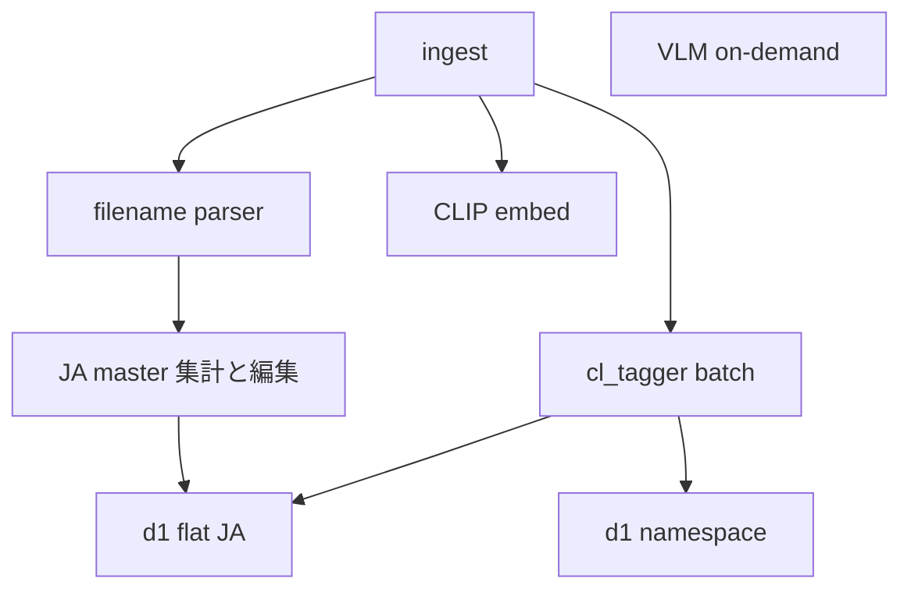

# モデルスタック — 今後の進め方

> **日付**: 2026-10-10  
> **前提**: [model-stack-pilot-findings.md](model-stack-pilot-findings.md)（パイロット go/no-go）  
> **ADR**: [role-based-model-stack.md](../decisions/role-based-model-stack.md)  
> **全体像**: [project-roadmap.md](project-roadmap.md)（Phase 2 との関係）

パイロット後の **実装・運用の順序**と、d1 の **拡張用途**（コレクション日本語語彙）をここに固定する。

**移行の入口**: 既存 VLM `auto` を捨てて組み直す手順は [tag-stack-migration.md](tag-stack-migration.md)（**M0 が最優先**）。

---

## 原則（変更しない）

| 語彙 | source（案） | 役割 |
|---|---|---|
| 日本語 filename | `filename` | 取り込み前の **確定**タグ。上書きしない |
| 英語 booru | `auto_tagger` | cl_tagger 全件。密度・英語検索 |
| namespace | `auto_d1` 等 | d1 **choice**（`種類/` `画角/` …） |
| 推定日本語 flat | `inferred_ja`（案） | d1 が **語彙リストから選択**した flat。filename ではない |
| VLM タグ | ~~`auto`~~ | **廃止** — 既存行は M0 で削除。キャプションのみ [vlm-on-demand](../decisions/vlm-on-demand.md) |

検索・UI では複数 source を **並列表示**する。1 リストにマージして provenance を失わない。

---

## 実装フェーズ（推奨順）

### フェーズ M0 — VLM auto 廃止（最優先）

[tag-stack-migration.md](tag-stack-migration.md) と同一。

1. DB バックアップ
2. `source='auto'` 全削除
3. `index_jobs` の `vlm_tag` pending 破棄
4. `scripts/purge_vlm_auto_tags.py`（dry-run）

**完了条件**: DB に `auto` タグなし。pixiv は filename のみ（一時的）→ 直後に A へ。

### フェーズ A — Tagger 本番

1. `replace_tags(conn, image_id, "auto_tagger", tags)` 相当の保存（スコアはメタ or タグ文字列に含めない方針を実装時に決定）
2. `scripts/tagger_batch.py` または `n8n_task.py tagger --limit N --route …`
3. 初回: **1 ルート・数百〜千枚**で DB + 検索/UI 確認
4. pixiv 36k は **VLM キュー破棄後** tagger バッチで付与

**完了条件**: 詳細/API で `auto_tagger` が見え、タグ検索にヒットする。

### フェーズ B — d1 namespace（既存 5 軸）

1. パイロット同様 `build_d1_question_set()` → 画像 + 任意で tagger top-N を state
2. 保存: namespace 形式 `種類/写真` 等（source は `auto_d1` 推奨）
3. confidence 閾値（例: &lt; 0.4 は付けない）

**完了条件**: G50 相当の軸別 accuracy を本番ルートで再確認。種類/ は必須、他軸は閾値運用。

### フェーズ C — d1 × コレクション日本語語彙（設計済み・後続）

[下記「日本語 master 語彙と d1」](#日本語-master-語彙と-d1) を実装。フェーズ A/B が動いてから。

### フェーズ D — UI / 検索

- API `tag_sources` 拡張（`auto_tagger`, `inferred_ja`, `auto_d1`）
- FTS: filename + inferred_ja + namespace + auto_tagger（英語）を対象に

### フェーズ E — Embedding（後回し · M5）

- CLIP 4 万埋め込みは維持（`cuda:1` / `SIFTIVEX_DEVICE`）
- EmbeddingGemma 2: **768d · 別 `model` 列 or 別テーブル**で全件再 embed
- **GPU**: [gpu-workloads.md](../setup/gpu-workloads.md) — Gemma は **cuda:1 または cuda:0（VLM 停止時）**、tagger/d1 と **別 GPU で並列**可

### フェーズ F — VLM

- llama オンデマンドのみ。ベースライン計測（V10）は任意

---

## 日本語 master 語彙と d1

### 目的

- **filename パーサーが付かない画像**に、コレクション慣習の日本語タグを付ける
- **tagger（英語）と filename 体系（日本語）の連絡** — 見た目をコレクション語彙に落とす
- d1 は **タグを生成しない**。master リストから **該当するものを choice / noul で選ぶ**

### Master 語彙の作り方（一度集計 → 足す・間引く）

1. **集計（1 回 + 増分）**  
   - SQL: `source='filename'` の tag 出現回数（ルート別・全体）  
   - 出力: `config/ja_tag_master.yaml` または `data/vocab/filename_master_<route>.yaml`（git 管理するかは要検討 — 個人タグ名が含まれるため **集計 JSON は data/ ローカル**でも可）

2. **人間が編集**  
   - **間引き**: 誤 typo・一度きりノイズ・検索に不要な語  
   - **追加**: 集計に無いが有用な語（`tag_vocabulary.yaml` の `preferred_flat_tags` 等と統合想定）  
   - 候補数は **この段階で決める**（d1 に載せる上限の根拠）。全 distinct を 1 問に載せない

3. **運用**  
   - ingest 増加時に集計だけ再実行 → diff で master 更新候補をレビュー

### 1 画像あたりの d1 の使い方（案）

```
tagger → 英語 top-N
master 語彙（数百語）→ ルールで 30〜80 語に絞る（tagger 関連・route・共起など）
d1:
  - 複数 noul: 「この画像に {tag} が当てはまるか」候補ごと（閾値以上のみ保存）
  - または テーマ別 choice（衣装 10 選び 1 など）
state: tagger hints 文字列（ablation で人数/画角に有効だったのと同型）
```

保存: **`inferred_ja`**（案）。`filename` とは別 source。UI で「推定」と表示。

### namespace との分担

| 種類 | 机制 |
|---|---|
| `種類/` `画角/` … | 既存 **namespace choice**（5 軸） |
| flat 日本語（制服、透け、…） | **master 語彙 + 絞り込み + d1** |

混同しない。namespace タグは `画角/全身` 形式、flat は `制服` のみ。

### パイロット（実装前の小さな確認）

- G30 または filename 無し画像数十枚
- master 候補 40 語 + d1 noul/choice
- 目視: filename 確定タグと inferred_ja の一致・有用性
- スクリプト: 将来 `scripts/build_ja_master.py` + `pilot_d1_ja_vocab.py`（未実装）

---

## 依存関係（図）



---

## ドキュメント更新タイミング

| タイミング | 更新先 |
|---|---|
| source 名確定 | [tags.md](../specs/tags.md), [data-model](../specs/data-model.md) |
| キュー・cron | [indexing.md](../specs/indexing.md), [n8n-indexing.md](../setup/n8n-indexing.md) |
| 方針 accepted | [role-based-model-stack.md](../decisions/role-based-model-stack.md) |

---

## 参照

- パイロット総括: [model-stack-pilot-findings.md](model-stack-pilot-findings.md)
- d1 ablation: `data/phase0/results/pilot_d1_ablation_g50.json`
- 走り書き: [model-stack-pilot-memo.md](model-stack-pilot-memo.md)
