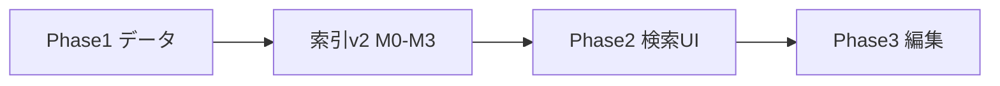
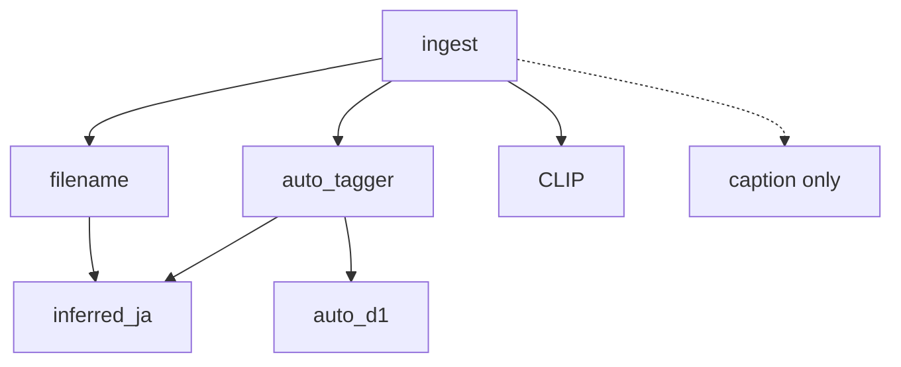

# プロジェクト・タスクパイプライン（現在地と全体計画）

> **最終更新**: 2026-10-10（タグスタック移行計画を反映）  
> **目的**: フェーズ計画（Phase 0〜4）と **索引 v2**（tagger / d1）の関係を一枚で把握する。  
> **実行手順**: [tag-stack-migration.md](tag-stack-migration.md)

---

## 0. いま決めたこと（2026-10-10）

- **VLM で付けた `auto` タグはすべて削除し、filename + tagger + d1 + α で組み直す。**
- Phase 2（React UI）より **先に** [tag-stack-migration.md](tag-stack-migration.md) の **M0〜M3** を進める。
- VLM は [vlm-on-demand.md](../decisions/vlm-on-demand.md) のまま **キャプション・例外のみ**（タグ主源に戻さない）。

---

## 1. ドキュメントの階層

| レイヤ | パス | 役割 |
|---|---|---|
| **次にやること** | [tag-stack-migration.md](tag-stack-migration.md) | M0 purge → M1 tagger → M2 d1 → M3 API |
| 全体像 | 本ファイル | Phase と索引 v2 の関係 |
| 実装順詳細 | [model-stack-rollout.md](model-stack-rollout.md) | A〜F（M フェーズと対応） |
| 北極星 | [blueprint.md](../../blueprint.md) | 思想（§タグ付けは ADR / 本移行が優先） |
| フェーズ | [phase-0.md](phase-0.md) … [phase-4.md](phase-4.md) | UI・機能段階 |
| インデックス | [specs/indexing.md](../specs/indexing.md) | cron・**目標フロー** |
| タグ契約 | [specs/tags.md](../specs/tags.md) | source 定義 |
| ADR | [role-based-model-stack.md](../decisions/role-based-model-stack.md) | スタック決定（パイロット後更新） |
| 評価 | [model-stack-pilot-findings.md](model-stack-pilot-findings.md) | go/no-go |

**読む順**: 本ファイル §0 → **tag-stack-migration** → model-stack-rollout → phase-2。

---

## 2. 現在地

### プロダクトフェーズ

| フェーズ | 状態 |
|---|---|
| Phase 0 | ✅ |
| Phase 1 | ✅ 40k+ embed、cron ingest/embed |
| Phase 2 | 🟡 API + mockup。React タスク表は pending |
| Phase 3–4 | ⬜ |

### タグ・索引（移行前）

| 項目 | 状態 |
|---|---|
| filename | ✅ 全ルート |
| VLM `auto` | ⚠️ **移行対象 — 削除予定**（~3.9k 枚） |
| auto_tagger / auto_d1 | ⬜ パイロットのみ |
| pixiv VLM キュー | ⚠️ **破棄予定**（~36k pending） |
| CLIP embed | ✅ |

### 完了済み（2026-10）

- モデルスタックパイロット（tagger / d1 / Gemma 試行）
- `scripts/model_stack_pilot.py`、G30 レビュー HTML
- findings + rollout + **本移行計画**

---

## 3. 二つのパイプライン

### A. Phase 0〜4（ユーザー機能）



**Phase 2 の前に M0〜M3** を挟む（タグが検索の前提になるため）。

### B. 索引 v2（1 枚あたりのメタデータ）



| 移行 M | Rollout | 内容 |
|---|---|---|
| **M0** | — | VLM auto 削除・キュー停止 |
| **M1** | A | cl_tagger 本番 |
| **M2** | B | d1 namespace |
| **M3** | D | 検索・API・バッチ UI |
| **M4** | C | JA master + inferred_ja |
| **M5** | E/F | Gemma / VLM caption |

---

## 4. 直近の作業順（実装）

```
1. M0  purge_vlm_auto_tags（バックアップ → DELETE auto → VLM pending 削除）
2. M1  tagger_batch + under.iphone 試行 → pixiv 全件
3. M2  d1_batch + auto_d1
4. M3  search/API tag_sources 拡張（mockup と揃える）
5. Phase 2 React or mockup 昇格（並行可だが M3 後が楽）
6. M4  inferred_ja（余裕があれば）
```

---

## 5. GPU（3 枚）

重い推論は **GPU ごとにピン留め**。tagger / d1 / Gemma / CLIP を **別 `cuda:N` で並列バッチ**してよい（詳細 → [gpu-workloads.md](../setup/gpu-workloads.md)）。

| GPU | 実機 | 主用途 |
|---|---|---|
| cuda:0 | **RTX 5060 Ti** ~16G | llama VLM · d1 夜間 |
| cuda:1 | **RTX 3060** ~12G | CLIP cron · Gemma（時間帯分離） |
| cuda:2 | **RTX 2070 SUPER** ~8G | cl_tagger 本番 |

→ [gpu-workloads.md](../setup/gpu-workloads.md)（2026-10-10 実機確認）

---

## 6. コマンド早見

| 用途 | 今 | 移行後 |
|---|---|---|
| 取り込み | `make n8n-ingest` | 同左（VLM enqueue 廃止予定） |
| embed | `make n8n-embed` | 同左 |
| タグ | ~~VLM バッチ~~ | **`tagger_batch` / `d1_batch`** |
| パurge | — | **`purge_vlm_auto_tags.py`**（M0） |
| 試行 | `model_stack_pilot.py` | 本番バッチへ移行 |
| UI | `make mockup-dev` / `api-dev` | M3 で multi-source |

---

## 7. ドキュメント負債

| 項目 | 状態 |
|---|---|
| README → roadmap | ✅ |
| blueprint §タグ付け | ADR + 移行計画が優先。blueprint は後追い改訂 |
| indexing 目標フロー | ✅ 追記 |
| ingest が VLM を積むコード | M1 と同時に変更予定 |
| ADR accepted | 移行完了後に role-based-model-stack を accepted 化 |

---

## 8. リンク

- [GPU 配置](../setup/gpu-workloads.md)

- [タグスタック移行（実行）](tag-stack-migration.md)
- [Rollout A–F](model-stack-rollout.md)
- [Phase 2](phase-2.md)
- [indexing](../specs/indexing.md)
- [tags](../specs/tags.md)
