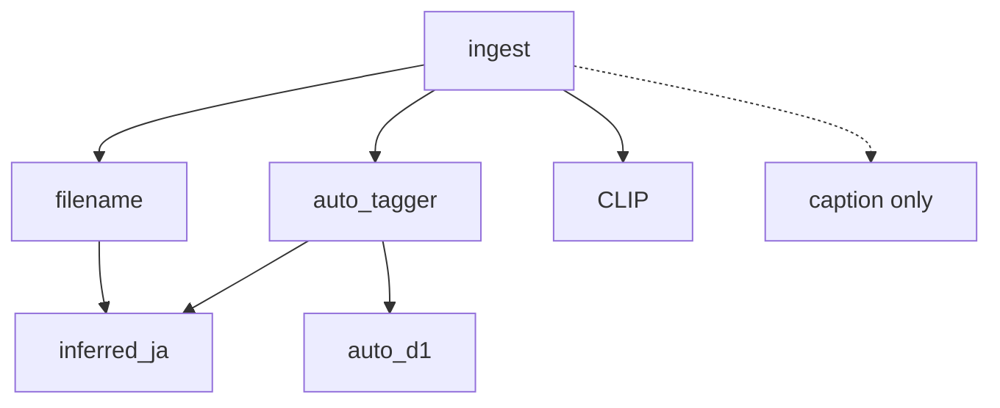

# プロジェクト・タスクパイプライン（現在地と全体計画）

> **最終更新**: 2026-10-12（mockup v3 · ドキュメント同期）  
> **目的**: フェーズ計画（Phase 0〜4）と **索引 v2**（tagger / d1）の関係を一枚で把握する。  
> **実行手順**: [tag-stack-migration.md](tag-stack-migration.md)  
> **UI**: [ui.md](../specs/ui.md) · [mockup-design-v3.md](mockup-design-v3.md)

---

## 0. いま決めたこと

### 2026-10-10（索引 v2）

- **VLM で付けた `auto` タグはすべて削除し、filename + tagger + d1 + α で組み直す。**
- Phase 2 UI より **先に** M0〜M3 を進める方針（M0〜M2 は完了）。
- VLM は [vlm-on-demand.md](../decisions/vlm-on-demand.md) のまま **キャプション・例外のみ**。

### 2026-10-12（Phase 2 UI）

- **mockup v3** を Phase 2 の参照実装とする（React は後から写す）。
- PC レイアウトは **案 B**（探索 ⇔ 閲覧）確定 · Layout Lab 廃止。
- 次の重点: **実利用検証**（[mockup-phase2.md](mockup-phase2.md)）· M3 残り（ingest 増分）· M4。

---

## 1. ドキュメントの階層

| レイヤ | パス | 役割 |
|---|---|---|
| **現在地** | 本ファイル | Phase + 索引 v2 + mockup |
| **Phase 2 検証** | [mockup-phase2.md](mockup-phase2.md) | チェックリスト |
| **索引 v2 実行** | [tag-stack-migration.md](tag-stack-migration.md) | M0〜M5 |
| 実装順詳細 | [model-stack-rollout.md](model-stack-rollout.md) | A〜F |
| UI 契約 | [ui.md](../specs/ui.md) | mockup v3 準拠 |
| 北極星 | [blueprint.md](../../blueprint.md) | 思想 |
| フェーズ | [phase-0.md](phase-0.md) … [phase-4.md](phase-4.md) | 機能段階 |

**読む順**: 本ファイル §2 → [mockup-phase2.md](mockup-phase2.md) → tag-stack-migration（M4 以降）。

---

## 2. 現在地

### プロダクトフェーズ

| フェーズ | 状態 |
|---|---|
| Phase 0 | ✅ |
| Phase 1 | ✅ 40k+ embed、cron ingest/embed |
| Phase 2 | 🟡 **mockup v3 + API** · 実利用検証中 · React 未作成 |
| Phase 3–4 | ⬜ |

### タグ・索引（本番 DB 概算 · 2026-10-12）

| 項目 | 状態 |
|---|---|
| filename | ✅ 全ルート |
| VLM `auto` | ✅ **削除済**（0 行） |
| auto_tagger | ✅ **40,305 / 40,320** 枚 |
| auto_d1 | ✅ **40,305 / 40,320** 枚 |
| inferred_ja | ⬜ M4 未着手 |
| pixiv VLM キュー | ✅ pending 0 |
| CLIP embed | ✅ 40,305 |
| tagger/d1 jobs pending | ✅ 0 |

### UI（mockup v3）

| 項目 | 状態 |
|---|---|
| 探索 ⇔ 閲覧 · サイドバーフィルタ | ✅ |
| 4 レイアウト · テーマ · 設定/API/索引 | ✅ |
| source 別タグ · 作品 page strip | ✅ |
| レスポンシブ（PC / tablet / phone） | ✅ |
| 旧 v2 | `mockup/archive/v2/` |

---

## 3. 二つのパイプライン

### A. Phase 0〜4（ユーザー機能）


### B. 索引 v2（1 枚あたりのメタデータ）



| 移行 M | Rollout | 内容 | 状態 |
|---|---|---|---|
| **M0** | — | VLM auto 削除・キュー停止 | ✅ |
| **M1** | A | cl_tagger 本番 | ✅（M1.5 ingest 増分は要確認） |
| **M2** | B | d1 namespace | ✅ |
| **M3** | D | 検索・API・進捗 UI | 🟡 おおむね完了 |
| **M4** | C | JA master + inferred_ja | ⬜ |
| **M5** | E/F | Gemma / VLM caption | ⬜ |

---

## 4. 直近の作業順（実装）

```
1. ✅ M0〜M2  本番 DB（tagger/d1 ~40k）
2. 🟡 M3      検索/API/mockup — 残: ingest 増分 tagger · 移行チェックリスト
3. **今**     Phase 2 実利用検証（mockup-phase2 チェックリスト）
4. 次         query-language / api 仕様の確定 · 大規模一覧方針
5. 後         M4 inferred_ja · React 昇格 or 継続 mockup · M5
```

---

## 5. GPU（3 枚）

重い推論は **GPU ごとにピン留め**（[gpu-workloads.md](../setup/gpu-workloads.md)）。

| GPU | 実機 | 主用途 |
|---|---|---|
| cuda:0 | **RTX 5060 Ti** ~16G | llama VLM · d1 夜間 |
| cuda:1 | **RTX 3060** ~12G | CLIP cron · Gemma |
| cuda:2 | **RTX 2070 SUPER** ~8G | cl_tagger 本番 |

---

## 6. コマンド早見

| 用途 | コマンド |
|---|---|
| API | `make api-dev`（:8787） |
| UI | `make mockup-dev`（:5199） |
| 取り込み | `make n8n-ingest` |
| embed | `make n8n-embed` |
| タグバッチ | `scripts/tagger_batch.py` · `scripts/d1_batch.py` |
| M0 purge | `scripts/purge_vlm_auto_tags.py` |

---

## 7. ドキュメント負債

| 項目 | 状態 |
|---|---|
| README · roadmap · ui.md · mockup-phase2 | ✅ 2026-10-12 同期 |
| blueprint §タグ付け | ADR + 移行計画が優先 |
| query-language.md · api.md | 部分実装 · 仕様確定が残り |
| ingest 増分 → tagger キュー | コード監査 · cron 文書化 |
| ADR accepted | 移行完了後に role-based-model-stack を accepted 化 |

---

## 8. リンク

- [GPU 配置](../setup/gpu-workloads.md)
- [Mockup v3 設計](mockup-design-v3.md)
- [Phase 2 検証](mockup-phase2.md)
- [タグスタック移行](tag-stack-migration.md)
- [Phase 2](phase-2.md)
- [indexing](../specs/indexing.md) · [tags](../specs/tags.md)
