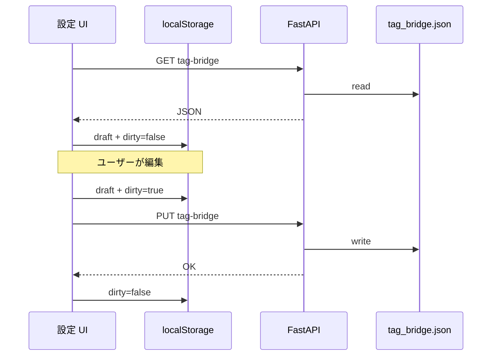

# Tag Bridge 仕様（辞書・API・検索展開）

> **状態**: 草案（2026-10-12）  
> **決定**: [tag-bridge.md](../decisions/tag-bridge.md)  
> **参照**: [tags.md](tags.md), [query-language.md](query-language.md), [api.md](api.md)

## 目的

英語 `auto_tagger` と日本語 `filename` 等を **DB 上では統合せず**、ユーザー向けには **1 つのラベルで検索・参照**できるようにする。

## データモデル（ファイル）

**パス（既定）**: `data/tag_bridge.json`（`data/` は gitignore · 正本はサーバー上）。スキーマ例: [config/tag_bridge.json.example](../../config/tag_bridge.json.example)

**スキーマ v1** — エントリの flat リストのみ（concept id なし）。

```json
{
  "version": 1,
  "updated_at": "2026-10-12T00:00:00Z",
  "entries": [
    {
      "label": "制服",
      "members": [
        { "source": "filename", "tag": "制服" },
        { "source": "auto_tagger", "tag": "serafuku" },
        { "source": "auto_tagger", "tag": "school_uniform" }
      ]
    }
  ]
}
```

| フィールド | 必須 | 説明 |
|---|---|---|
| `version` | yes | スキーマ版。v1 固定 |
| `updated_at` | yes | ISO8601。PUT 時にサーバーが更新 |
| `entries[].label` | yes | 代表表示・検索キー（主に日本語）。**エントリ内で一意** |
| `entries[].members[]` | yes | OR 条件。1 件以上 |
| `members[].source` | yes | `filename` \| `auto_tagger` \| `auto_d1` \| `inferred_ja` \| `manual_added` |
| `members[].tag` | yes | 完全一致（namespace タグは `種類/イラスト` 形式） |

**制約（v1）**

- 同一 `(source, tag)` は **全体で 1 エントリのみ**（重複は PUT 時 400）。
- `label` 重複も 400。
- `members` が空のエントリは不可。

**意図的に無いもの（v1）**

- exclude メンバー（除外はクエリの `-tag:` のまま）
- 優先度・スコア・自動翻訳テーブル
- Danbooru 全語彙インポート

## API

### `GET /api/settings/tag-bridge`

- **200**: 上記 JSON 本体（ファイル無し時は `{ "version": 1, "updated_at": "…", "entries": [] }`）

### `PUT /api/settings/tag-bridge`

- **Body**: 同上 JSON（`updated_at` は無視してサーバーが上書き可）
- **200**: 保存後の JSON
- **400**: スキーマ違反・重複 member

認証: v1 は **ローカル API 前提**（127.0.0.1）。将来必要ならトークン。

### 検索への組み込み

既存 `GET /api/images` の tag 条件に、bridge 展開を **サーバー内部**で適用する。

1. クエリ文字列・`include_tag` の各トークン `T` について:
   - bridge に `label === T` のエントリがあれば、`members` を **include 集合に OR 追加**（重複除去）。
   - エントリが無ければ、従来どおり `T` を 1 タグとして扱う。
2. `source` 付き member は「その source のタグのみ一致」でフィルタ（FTS/SQL 側で source 条件）。
3. **複数 include トークン**は従来どおり **AND**（bridge 展開後も AND）。

（mockup は `tag:制服` を parse 後 `include_tag` に載せるか、`q` に残すかは mockup 実装時に統一。展開は API が担う。）

## 表示（mockup / UI）

| 場所 | 動作 |
|---|---|
| 詳細 · Tagger チップ | member が bridge に含まれる → `serafuku（制服）` など。原文維持 |
| ファセット | v2 候補: label 行で members 合算カウント。v1 は手動 label のみ一覧でも可 |
| 設定 · タグの橋渡し | entries CRUD · 未保存バッジ · **サーバーに保存** · 破棄 · export/import |

## localStorage（mockup ドラフト）

| キー | 内容 |
|---|---|
| `siftivex.mockup.tagBridge.draft` | `{ entries, dirty: boolean, fetchedAt }` |
| `siftivex.mockup.prefs` | 既存（テーマ等）と独立 |

**フロー**



- **dirty=true** のまま GET し直す場合: 確認ダイアログ（破棄 / キャンセル）。
- API 未接続: ドラフト編集 + JSON export のみ。検索 bridge は効かない。

## 半自動候補（将来）

**共起レポート**（オフライン script または API 1 本）:

- 入力: 最小共起回数、ルート、上位 N ペア
- 出力: `{ label_suggestion, filename_tag, tagger_tag, count }[]` — **entries には自動投入しない**
- UI: 「候補を採用」→ ドラフトに 1 エントリ追加 → ユーザーが push

## テスト観点

- `tag:制服` で filename のみ / tagger のみ / 両方の画像が混在ヒット
- bridge 無しの `tag:serafuku` は従来どおり
- PUT 重複 member で 400
- push 後 GET 検索が即反映（API プロセスはファイル再読込 or mtime キャッシュ）

## 関連

- M4 [inferred_ja](../plans/tag-stack-migration.md) — bridge の member に `inferred_ja` を後から足せる
- [ui.md](ui.md) — 設定ドロワーにセクション追加予定
